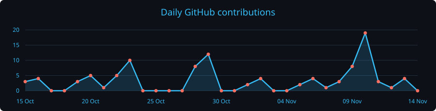

<!-- 🌊 Hero Banner -->

  

  

  
  

  
  
  

---

### 🚀 About Me

I'm **Yiyang (Ethan) Jia**, a PhD student in Computer Science at **University College London (UCL)**. I study **continual learning in robotics**: how can a robot learn a new skill without losing an old one, and recognise when to use what it already knows?

My current work focuses on humanoids. When a new request arrives while the robot is already moving, how should it adapt without being told exactly where one task ends and the next begins?

Previously, I worked on embodied intelligence at the Institute of Automation, Chinese Academy of Sciences (CASIA).

- 🎓 **UCL** — MSc Robotics and AI, **Distinction (76.71/100)**
- 🎓 **UESTC** — BEng Robot Engineering, GPA **3.93/4.0**, National Scholarship
- 🧠 **Interests** — Robot perception / manipulation / interaction, RL, biologically-inspired AI

---

### 🔬 Research Highlights

#### 📈 Self-Motivated Growing Neural Network (SMGrNN) *Neurocomputing, 2026*
Yiyang Jia and Chengxu Zhou. We studied whether a robot controller needs a fixed-size network: local rules let the network add or prune neurons as it learns a control task.

[Journal article](https://doi.org/10.1016/j.neucom.2026.134581) · [arXiv](https://arxiv.org/abs/2512.12713)

#### 🛡️ ForesightSafety-VLA *IROS, 2026*
Mingyang Lyu, Yinqian Sun, Yiyang Jia et al. A robot can finish a task and still do something unsafe along the way. Our benchmark tracks both success and risks during execution across **66 RoboTwin scenarios**.

[Paper](https://arxiv.org/abs/2606.27079) · [Code and demos](https://github.com/tuotuoLyu/ForesightSafety-VLA)

#### 🧠 Dynamic SNN for Embodied Continual Learning
- Continual learning framework based on dynamic spiking neural networks for task-agnostic structural adaptation.
- SNN-RL training stack with LIF neurons and surrogate gradients on DMControl.

#### 🐒 Self-Recognition in Embodied Intelligence
- Interdisciplinary work connecting AI self-recognition with experiments on bodily self-recognition.
- Isaac Lab and DreamerV3 for multi-perspective self-recognition.

---

### 🛠️ Technical Skills

| Category | Tools & Technologies |
| :--- | :--- |
| **Languages & Frameworks** |     |
| **Simulators** | `Isaac Lab` · `MuJoCo` · `DMControl` · `RoboTwin` |
| **Algorithms** | RL (PPO, DreamerV3) · Imitation Learning (DAgger) · NMPC · Dynamic Graph SNN |

---

### 🏆 Selected Achievements

- **MSc with Distinction**, UCL — Computer Vision 89.03, Legged Robotics 80.47
- **National Scholarship** (2021) & **Outstanding Engineer** award (2023)

---

### 📊 GitHub Stats

  

<!-- 🎲 3D Contribution Chart — generated by .github/workflows/3d-contrib.yml -->

  

<!-- 🐍 Contribution Snake — generated by .github/workflows/snake.yml -->

  

<!-- 💻 Languages — generated by .github/workflows/languages.yml -->

  

  

---

### 📬 Contact

- ✉️ **Email** — [yiyang.jia.24@ucl.ac.uk](mailto:yiyang.jia.24@ucl.ac.uk)
- 📄 **arXiv** — [2512.12713](https://arxiv.org/abs/2512.12713)
- 🌐 **English** — IELTS 7.5

<i>"Exploring the intersection of biological plasticity and robotic autonomy."</i>

  

